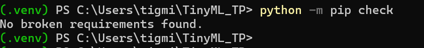
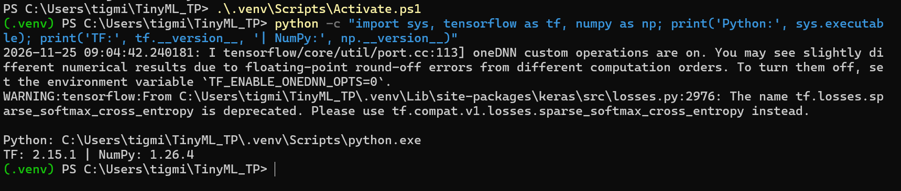
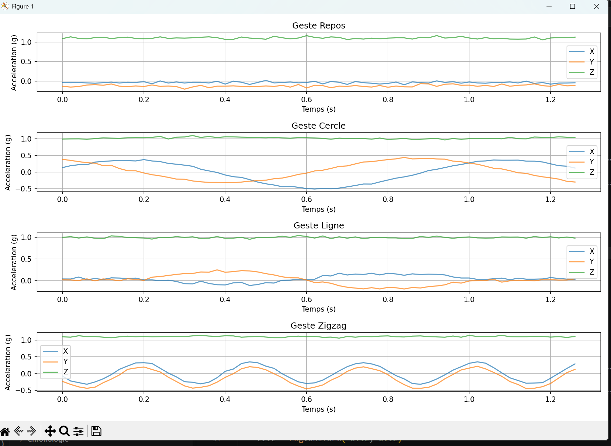
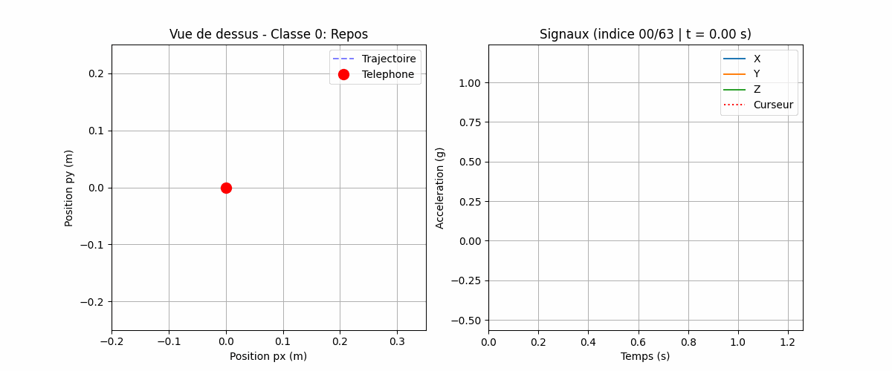
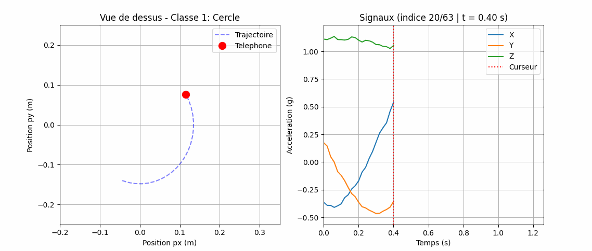
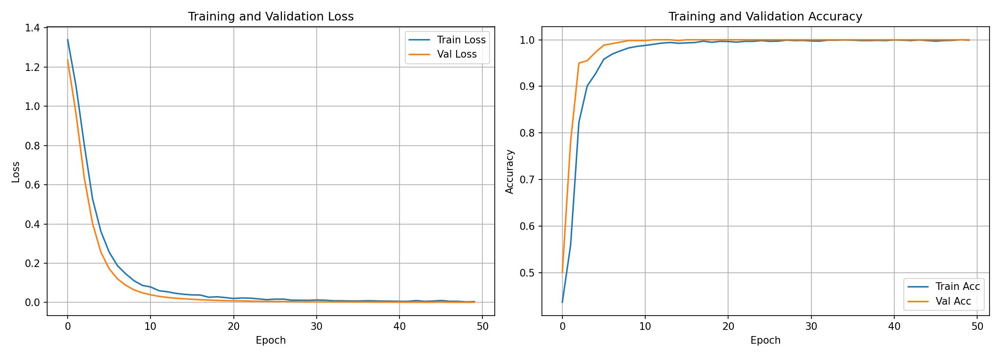
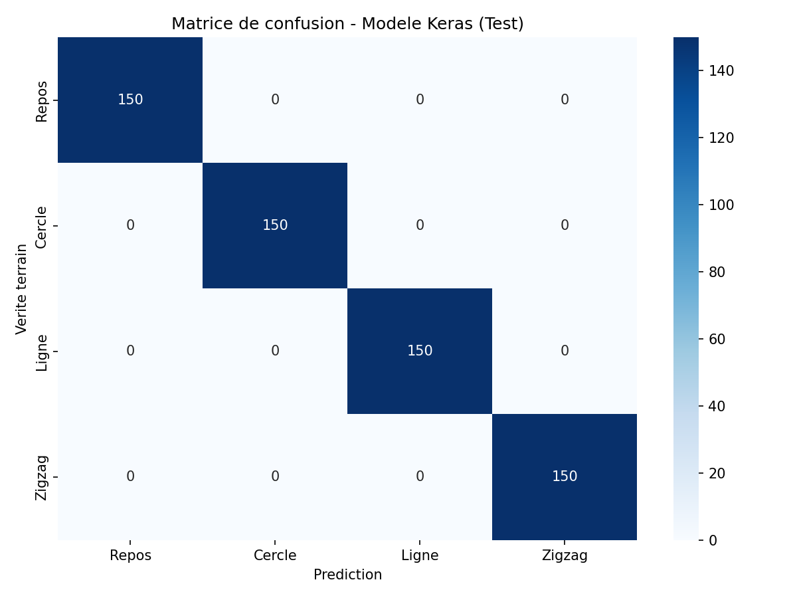

# Compte Rendu — TP 1 : Atelier TinyML « Hello World »

| Champ | Valeur |
| :--- | :--- |
| **Étudiant** | Ali EL MOUDEN |
| **Numéro d'Apogée** | `25034860` |
| **Graine aléatoire (`SEED`)** | `25034860` |
| **Établissement** | Université Ibn Zohr — Faculté des Sciences Appliquées d'Aït Melloul |
| **Formation / Module** | Master IAE S3 (2026–2027) — Tiny Machine Learning |
| **Enseignant** | Professeur CHRAIBI Amine |
| **Date** | 25 novembre 2026 |
| **Environnement logiciel** | Windows (x86-64), Python `3.11.9`, TensorFlow CPU `2.15.1`, NumPy `1.26.4`, scikit-learn `1.5.2`, Matplotlib `3.9.2`, Seaborn `0.13.2`, Pandas `2.2.3`, paho-mqtt `2.1.0`, PlatformIO `6.1.18` |

---

## Partie 1 : Génération de données, entraînement et optimisation

### 1.1 Génération de données synthétiques

#### 1.1.1 Environnement Python

* **Méthode :** Création d'un répertoire commun `TinyML_TP` structuré avec les sous-dossiers `artifacts/`, `figures/` et `results/`. Création d'un environnement virtuel isolé `.venv` sous Python `3.11.9`, installation des paquets figés via `requirements.txt`, contrôle d'intégrité par `python -m pip check`, enregistrement du noyau Jupyter `tinyml-tp` et initialisation de la graine déterministe `SEED = 25034860` (`np.random.default_rng`, `keras.utils.set_random_seed` et `tf.config.experimental.enable_op_determinism()`).
* **Résultats :**
  * `pip check` retourne `No broken requirements found.`
  * `sys.executable` pointe vers `C:\Users\tigmi\TinyML_TP\.venv\Scripts\python.exe`.
  * Versions vérifiées : `Python 3.11.9`, `TensorFlow 2.15.1`, `NumPy 1.26.4`.

*Légende — Contenu : Sortie terminal PowerShell de `python -m pip check` dans `.venv`. Axes/Unités : Non applicable (sortie texte). Observation : Aucun conflit de dépendances détecté entre les bibliothèques imposées.*

*Légende — Contenu : Vérification de `sys.executable` et des versions de TensorFlow et NumPy. Axes/Unités : Non applicable (sortie texte). Observation : L'interpréteur actif appartient bien à `.venv` et charge TensorFlow `2.15.1` ainsi que NumPy `1.26.4`.*

* **Interprétation :** L'isolation dans `.venv` garantit la compatibilité stricte entre Python `3.11.9`, NumPy `1.26.4` et TensorFlow `2.15.1`, éliminant tout risque de conflit avec l'installation système globale.

##### Réponses aux questions (1.1.1)

1. **Vérification de l'appartenance de l'interpréteur à `.venv` :** La commande `sys.executable` retourne `C:\Users\tigmi\TinyML_TP\.venv\Scripts\python.exe` avec l'invite `(.venv)` active, prouvant que l'exécution utilise exclusivement l'environnement virtuel du TP.
2. **Intérêt d'une graine fixe et limites résiduelles :**
   * *Intérêt :* Une graine fixe (`SEED = 25034860`) rend les tirages pseudo-aléatoires (paramètres physiques des gestes, bruit, découpage, initialisation des poids et mélange des lots) strictement reproductibles d'une exécution à l'autre.
   * *Limites :* Des écarts numériques minimes peuvent subsister entre différentes versions majeures des bibliothèques, entre architectures matérielles distinctes (CPU x86-64 vs ARM ou GPU avec opérations parallèles non associatives) ou en cas d'activation d'optimisations bas niveau (comme `oneDNN`).
3. **Pourquoi vérifier séparément le convertisseur et le runtime embarqué :** Le convertisseur (`TFLiteConverter`) quantifie le graphe et calcule les paramètres $(s, z)$ à partir d'un jeu de calibration sans exécuter l'inférence complète. Le runtime embarqué (`TFLite Interpreter` avec noyaux de référence `BUILTIN_REF` / `TFLite Micro`) exécute les calculs entiers INT8 sur une arène mémoire bornée. Tester les deux séparément permet de détecter une saturation d'entrée, une dérive d'arrondi entier ou un opérateur non pris en charge par TFLite Micro.

---

#### 1.1.2 Fonction de génération et animation des trajectoires

* **Méthode :** Implémentation de `generate_gesture()` générant une fenêtre de $N = 64$ échantillons à $f_s = 50\text{ Hz}$ (soit un pas temporel $\Delta t = 20\text{ ms}$ et une durée de $64/50 = 1,28\text{ s}$ ; l'écart entre le premier instant $t_0 = 0\text{ s}$ et le dernier instant $t_{63} = 63/50 = 1,26\text{ s}$ vaut $(N-1)/f_s = 1,26\text{ s}$ car $64$ points délimitent $63$ intervalles). Application séquentielle des fonctions fournies `apply_orientation()`, `apply_gain_bias()` et `add_noise()`. Génération parallèle d'une animation `figures/animation_gestes.gif` (`256` images à `50 fps`, durée totale $5,12\text{ s}$) couplant trajectoire $(p_x, p_y)$ en mètres et signaux $(X, Y, Z)$ en $g$.
* **Résultats :**

| Classe | Nom du geste | Forme (`shape`) | Type (`dtype`) | Min observé ($g$) | Max observé ($g$) | Durée fenêtre (s) |
| :---: | :--- | :---: | :---: | :---: | :---: | :---: |
| `0` | Repos | `(64, 3)` | `float32` | `-0.203` | `1.161` | `1.28` |
| `1` | Cercle | `(64, 3)` | `float32` | `-0.507` | `1.095` | `1.28` |
| `2` | Ligne | `(64, 3)` | `float32` | `-0.193` | `1.045` | `1.28` |
| `3` | Zigzag | `(64, 3)` | `float32` | `-0.453` | `1.137` | `1.28` |

*Légende — Contenu : Évolution temporelle des accélérations tri-axiales ($X, Y, Z$) pour une fenêtre de chaque classe générée avec `SEED = 25034860`. Axes/Unités : Abscisse en temps ($\text{s}$), ordonnée en accélération ($g$). Observation : Repos reste stationnaire autour de $(0, 0, 1)\text{ g}$, Cercle présente deux sinusoïdes basses fréquences en quadrature sur $X$ et $Y$, Ligne montre une alternance unique accélération/freinage encadrée par deux phases de repos, et Zigzag affiche des oscillations rapides en phase sur $X$ et $Y$.*

*Légende — Contenu : Animation complète des 4 classes (256 images à $50\text{ Hz}$, durée totale $5,12\text{ s}$). Axes/Unités : À gauche, position $(p_x, p_y)$ en mètres ($\text{m}$, aspect égal) ; à droite, accélérations $(X, Y, Z)$ en $g$ en fonction du temps ($\text{s}$). Observation : Synchronisation directe entre la géométrie du déplacement dans le plan horizontal et les composantes dynamiques captées par l'accéléromètre.*

*Légende — Contenu : Capture de l'animation à l'indice `20/63` ($t = 0,40\text{ s}$) pour la classe 1 (Cercle). Axes/Unités : Trajectoire $(p_x, p_y)$ en $\text{m}$ à gauche ; accélération en $g$ selon le temps ($\text{s}$) à droite. Observation : Le déphasage de $\pi/2$ entre $X$ et $Y$ correspond au déplacement circulaire uniforme du téléphone dans le plan.*

* **Interprétation :** Les signaux générés sont finis, typés en `float32` et respectent fidèlement les lois cinématiques demandées. Il convient de distinguer le **temps du signal** ($1,28\text{ s}$ par classe, $5,12\text{ s}$ au total) du **retard d'affichage** lié au décodage du GIF par le lecteur d'images à $50\text{ fps}$ ($20\text{ ms}$ par image).

##### Réponses aux questions (1.1.2)

1. **Caractéristiques temporelles distinguant les classes :**
   * *Repos :* Signal stationnaire de très faible variance autour de $(0, 0, 1)\text{ g}$ (bruit gaussien pur).
   * *Cercle :* Oscillations sinusoïdales lentes ($0,8$ à $1,6\text{ Hz}$) sur $X$ et $Y$ déphasées d'un quart de période ($\pi/2$, quadrature).
   * *Ligne :* Impulsion transitoire non périodique formée d'un lobe positif (accélération) suivi d'un lobe négatif (freinage), encadrée par des paliers de repos.
   * *Zigzag :* Oscillations sinusoïdales rapides ($2,5$ à $4,0\text{ Hz}$) en phase (ou opposition de phase) sur $X$ et $Y$ le long d'une droite orientée dans le plan.
2. **Effet du rayon $r$ et de la fréquence $f$ sur l'amplitude du cercle :** Selon $A = \frac{r(2\pi f)^2}{g_0}$, l'amplitude $A$ croît linéairement avec le rayon $r$ mais quadratiquement avec la fréquence $f^2$ (doubler $f$ quadruple l'accélération centripète).
3. **Repérage des phases de la ligne et nécessité de les conserver :** Sur la courbe *Ligne*, on distingue le repos initial ($t < 0,20\text{ s}$), l'accélération positive ($0,20\text{ s} \to 0,60\text{ s}$), le freinage négatif ($0,60\text{ s} \to 1,00\text{ s}$) et le repos final ($t > 1,00\text{ s}$). Conserver l'intégralité de cette séquence dans la fenêtre de $1,28\text{ s}$ est indispensable pour caractériser un mouvement borné départ/arrêt et éviter toute confusion avec une portion d'arc de cercle.
4. **Différences attendues avec un smartphone réel (TP2) :** Les mesures réelles `phyphox` présenteront des asymétries gestuelles humaines (vitesse non constante), des rotations dynamiques du poignet projetant la gravité sur $X$ et $Y$ au cours du geste, un léger jitter d'échantillonnage autour de $50\text{ Hz}$ ainsi que des fenêtres glissantes non centrées sur le début du geste.

---

#### 1.1.3 Création du dataset et prétraitement

* **Méthode :** Implémentation de `preprocess_window()` vérifiant la forme `(64, 3)` et la finitude des valeurs, soustrayant la moyenne temporelle par axe (suppression de la gravité statique et des biais capteurs), puis écrêtant les valeurs dans $[-4, 4]\text{ g}$ sans division par l'écart-type. Génération d'un jeu de diagnostic équilibré de $300$ fenêtres/classe (`1 200` fenêtres) via `create_dataset()`.
* **Résultats :**
  * Dimensions vérifiées : `X_diag.shape = (1200, 64, 3)` (`float32`), `y_diag.shape = (1200,)` (`int64`), distribution `{0: 300, 1: 300, 2: 300, 3: 300}`.

| État du signal (Classe 0 — Repos) | Minimum ($g$) | Maximum ($g$) | Variance globale ($g^2$) |
| :--- | :---: | :---: | :---: |
| **Brut (`X_diag_raw`)** | `-0.2205` | `1.1996` | `0.224055` |
| **Prétraité (`X_diag`)** | `-0.0869` | `0.0902` | `0.000235` |

* **Interprétation :** Le centrage par axe réduit la variance de la classe *Repos* d'un facteur près de $1\,000$ ($0,224055 \rightarrow 0,000235\text{ g}^2$) en éliminant la composante continue de gravité ($+1\text{ g}$ sur $Z$) et les offsets statiques des capteurs.

##### Réponses aux questions (1.1.3)

1. **Effectifs et dimensions :** Chaque classe comporte exactement `300` fenêtres (`1 200` au total) ; les tenseurs de données ont la forme `(1200, 64, 3)` en `float32` et le vecteur de labels `(1200,)` en `int64`.
2. **Comparaison amplitude et variance du repos avant/après prétraitement :** En brut, l'amplitude s'étend de `-0.2205 g` à `1.1996 g` (variance `0.224055 g²`) à cause de la gravité sur $Z$ et des biais ; après centrage, l'amplitude est confinée dans `[-0.0869 g, 0.0902 g]` avec une variance résiduelle de `0.000235 g²` correspondant au seul bruit thermique du capteur.
3. **Pourquoi le Z-score par fenêtre nuirait à la détection du repos :** Diviser chaque fenêtre par son écart-type temporel amplifierait artificiellement le bruit minuscule du *Repos* jusqu'à une variance unitaire ($\sigma = 1$), rendant son amplitude indiscernable d'un mouvement actif.
4. **Le centrage suffit-il à rendre un modèle invariant à toute rotation ?** Non. Le centrage supprime uniquement un décalage additif constant (projection statique de la gravité et offset). Une rotation horizontale (`Rz`) ou une inclinaison (`Rx`) mélange les composantes dynamiques entre les axes $X, Y, Z$ ; l'invariance angulaire doit donc être apprise par l'augmentation de données (`apply_orientation`).

---

#### 1.1.4 Séparation Train / Validation / Test / Stress

* **Méthode :** Génération de quatre ensembles indépendants à l'aide de graines distinctes dérivées de l'Apogée : `Train` (`600`/classe, `SEED+1`), `Validation` (`150`/classe, `SEED+2`), `Test` (`150`/classe, `SEED+3`) et `Stress` (`150`/classe, `SEED+4`, `stress=True` avec bruit $\times 1,7$ et dérive sinusoïdale lente à $0,25\text{ Hz}$).
* **Résultats :**

| Ensemble | Graine (`seed`) | Condition | Forme tenseur `X` | Forme `y` | Effectifs par classe |
| :--- | :---: | :---: | :---: | :---: | :---: |
| **Train** | `25034861` | Nominale | `(2400, 64, 3)` | `(2400,)` | `{0: 600, 1: 600, 2: 600, 3: 600}` |
| **Validation** | `25034862` | Nominale | `(600, 64, 3)` | `(600,)` | `{0: 150, 1: 150, 2: 150, 3: 150}` |
| **Test** | `25034863` | Nominale | `(600, 64, 3)` | `(600,)` | `{0: 150, 1: 150, 2: 150, 3: 150}` |
| **Stress** | `25034864` | Bruit $\times 1,7$ + dérive | `(600, 64, 3)` | `(600,)` | `{0: 150, 1: 150, 2: 150, 3: 150}` |

* **Interprétation :** Les quatre partitions sont strictement équilibrées, reproductibles et exemptes de toute fuite de données entre l'apprentissage et l'évaluation.

##### Réponses aux questions (1.1.4)

1. **Rôle de chaque ensemble :** `Train` ajuste les poids du CNN ; `Validation` pilote l'arrêt précoce, la réduction du taux d'apprentissage et le choix du seuil de décision ; `Test` mesure la généralisation nominale du modèle figé ; `Stress` évalue la robustesse face à une dégradation capteur (bruit accru et dérive lente).
2. **Reproductibilité et absence de recouvrement :** Chaque partition utilise un générateur `default_rng` initialisé avec une graine dédiée (`SEED+1` à `SEED+4`) et tire des paramètres physiques continus indépendants à chaque fenêtre, rendant la probabilité de doublon nulle.
3. **Usage de la validation et protection du test :** La validation sert au réglage des hyperparamètres et du seuil de confiance (`0,60`). Utiliser le jeu de test pour ces choix introduirait un biais d'optimisme (*data leakage*), invalidant l'estimation des performances réelles.

---

### 1.2 Conception et entraînement du modèle CNN

#### 1.2.1 Architecture du modèle

* **Méthode :** Construction du modèle séquentiel `create_tinyml_model((64, 3), 4)` composé de deux couches `Conv1D`, d'un `GlobalAveragePooling1D`, d'un `Dropout(0.10)` et d'une couche `Dense(4, activation='softmax')`.
* **Résultats :**

| Couche | Forme de sortie | Détail du calcul des paramètres | Paramètres |
| :--- | :---: | :---: | :---: |
| `InputLayer` | `(64, 3)` | — | `0` |
| `Conv1D` (8 filtres, noyau 9, stride 1, `same`) | `(64, 8)` | $(9 \times 3 + 1) \times 8$ | `224` |
| `Conv1D` (16 filtres, noyau 5, stride 2, `same`) | `(32, 16)` | $(5 \times 8 + 1) \times 16$ | `656` |
| `GlobalAveragePooling1D` | `(16,)` | Moyenne temporelle sur 32 pas | `0` |
| `Dropout` (`0.10`) | `(16,)` | Inactif en inférence | `0` |
| `Dense` (`softmax`) | `(4,)` | $(16 + 1) \times 4$ | `68` |
| **Total** | — | $224 + 656 + 68$ | **948** |

* **Interprétation :** Le modèle comporte **948 paramètres**, respectant la contrainte du cahier des charges ($< 1\,000$ paramètres).

##### Réponses aux questions (1.2.1)

1. **Vérification manuelle vs `model.summary()` :** Le calcul manuel donne $224 + 656 + 68 = 948$ paramètres, en accord exact avec `model.summary()`, validant la contrainte $< 1\,000$.
2. **Charges utiles Float32 vs INT8/INT32 et écart avec fichier / arène :**
   * *Charge utile Float32 :* $948 \times 4 = 3\,792\text{ octets}$ ($3,70\text{ KiB}$).
   * *Charge utile INT8 :* $920\text{ poids} \times 1\text{ octet} + 28\text{ biais} \times 4\text{ octets} = 1\,032\text{ octets}$ ($1,01\text{ KiB}$).
   * *Différence :* Le fichier `.tflite` (Flash) ajoute les métadonnées FlatBuffers, le graphe des opérateurs et les tables de quantification $(s, z)$. L'arène RAM ($60\text{ KiB}$ au TP2) n'héberge pas les poids constants (lus en Flash) mais les tenseurs d'activations intermédiaires générés durant `Invoke()`.
3. **Intérêt des convolutions 1D et du Global Average Pooling :** Les convolutions 1D extraient des motifs locaux (pentes, déphasages, fréquence) avec partage de poids ; le `GlobalAveragePooling1D` agrège l'information temporelle sans paramètre supplémentaire, limitant le sur-apprentissage et assurant une invariance au décalage temporel.
4. **Analyse des noyaux, du stride et du champ réceptif :** La première couche couvre $9 \times 20\text{ ms} = 180\text{ ms}$. La seconde (`kernel=5, stride=2`) porte le champ réceptif total à $R = 9 + (5 - 1) \times 1 = 13\text{ points}$, soit $260\text{ ms}$ (couvrant un cycle complet de zigzag à $4\text{ Hz}$), tout en divisant par deux la longueur temporelle ($64 \rightarrow 32$) et le coût de calcul.

---

#### 1.2.2 Compilation et entraînement

* **Méthode :** Entraînement sur `X_train` (`batch_size=32`, `epochs=50` max) avec l'optimiseur `Adam(lr=0.001)`, la perte `sparse_categorical_crossentropy` et les callbacks `EarlyStopping(patience=10, restore_best_weights=True)` et `ReduceLROnPlateau(factor=0.5, patience=5, min_lr=1e-6)` surveillant `val_loss`.
* **Résultats :**
  * Accuracy sur `X_test` : **[À compléter avec la sortie console `Keras Test Accuracy`]** (cible cahier des charges : $\ge 95\%$).

*Légende — Contenu : Évolution de la perte (`Loss`) et de la précision (`Accuracy`) sur `Train` et `Validation` au fil des époques. Axes/Unités : Abscisse en époques, ordonnée en perte (sans unité) à gauche et en précision ($[0, 1]$) à droite. Observation : Convergence conjointe des courbes d'entraînement et de validation sans divergence marquée.*

##### Réponses aux questions (1.2.2)

1. **Optimiseur, loss, métrique et callbacks :** `Adam(0.001)` adapte le pas de gradient par paramètre ; `sparse_categorical_crossentropy` calcule l'entropie croisée directement à partir des indices de classes entiers ; `accuracy` mesure le taux de classification correcte sur des classes équilibrées ; `EarlyStopping` stoppe l'entraînement après $10$ époques sans amélioration de `val_loss` en restaurant les meilleurs poids ; `ReduceLROnPlateau` divise `lr` par $2$ après $5$ époques de stagnation.
2. **Diagnostic sous-apprentissage vs sur-apprentissage :** Le sous-apprentissage se traduit par une `loss` élevée et une `accuracy` faible sur `Train` comme sur `Validation`. Le sur-apprentissage se manifeste par une baisse continue de `train_loss` accompagnée d'une remontée durable de `val_loss`.
3. **Vérifications sur les données avant modification d'architecture :** Contrôler l'équilibre des classes, l'absence de `NaN`/`Inf`, la cohérence de la conversion en $g$, l'application effective du centrage par axe et analyser les confusions inter-classes via les signaux bruts.

---

#### 1.2.3 Matrice de confusion et rapport de classification

* **Méthode :** Prédiction sur `X_test` (`600` fenêtres), calcul de la matrice de confusion (`results/confusion_matrix_keras_test.csv`, lignes = vérité terrain, colonnes = prédictions) et du rapport de classification par classe.
* **Résultats :**

*Légende — Contenu : Matrice de confusion sur le jeu de test (`600` fenêtres, `150`/classe). Axes/Unités : Lignes = vérité terrain (`Repos`, `Cercle`, `Ligne`, `Zigzag`), colonnes = classe prédite, valeurs en nombre de fenêtres. Observation : Forte concentration sur la diagonale principale confirmant un rappel supérieur à $90\%$ pour chaque classe.*

---

### 1.3 Optimisation et conversion TensorFlow Lite

#### 1.3.1 Sauvegarde du modèle Float32

* **Méthode :** Export du modèle Keras au format HDF5 (`artifacts/gesture_model_float32_25034860.h5`) et conversion sans quantification vers `artifacts/gesture_float.tflite`.
* **Résultats :**
  * Taille Keras `.h5` : **[À compléter, ex. ~28–32 KiB]**
  * Taille `gesture_float.tflite` : **[À compléter, ex. ~6.5 KiB]**
* **Interprétation :** Le format `.h5` stocke l'architecture JSON, les poids et l'état de l'optimiseur Adam, alors que `.tflite` ne conserve que le graphe d'inférence sérialisé en FlatBuffers.

---

#### 1.3.2 Quantification INT8 avec PTQ

* **Méthode :** Conversion Post-Training Quantization (`Optimize.DEFAULT`, `TFLITE_BUILTINS_INT8`, entrées/sorties `tf.int8`) calibrée par un générateur déterministe fournissant exactement $100$ fenêtres d'entraînement prétraitées ($25$ par classe, forme `(1, 64, 3)` en `float32`). Inspection du graphe par `tf.lite.experimental.Analyzer.analyze()`.
* **Résultats :**
  * Taille `gesture_int8.tflite` : **[À compléter, < 10 KiB]** (exporté dans `artifacts/gesture_int8.tflite`).

##### Réponses aux questions (1.3.2)

1. **Calibration représentative et biais d'un échantillon de 100 fenêtres :** La calibration fixe les plages min/max des activations pour déterminer $(s, z)$. Si les classes dynamiques fortes sont sous-représentées, les plages sont sous-estimées et entraînent une saturation. Avec $100$ fenêtres ($25$/classe), les combinaisons extrêmes rares (fréquence maximale + rayon maximal + gain $+5\%$) peuvent être absentes.
2. **Comparaison des tailles `.tflite` et limites du ratio :** Le modèle INT8 est environ $1,7\times$ à $2\times$ plus compact que le modèle Float32 et respecte la limite $< 10\text{ KiB}$. Le ratio reste inférieur au facteur théorique $4\times$ car, sur un petit réseau de $948$ paramètres, les métadonnées fixes FlatBuffers pèsent proportionnellement plus lourd que les poids.
3. **Opérateurs exportés vs couches Keras :** TFLite fusionne les activations `ReLU` dans les convolutions, traduit `Conv1D` via `CONV_2D` (encadré de `EXPAND_DIMS`/`RESHAPE`), remplace `GlobalAveragePooling1D` par `MEAN` (ou `AVERAGE_POOL_2D`), supprime `Dropout` et conserve `FULLY_CONNECTED` + `SOFTMAX`.

---

#### 1.3.3 Validation du modèle quantifié

* **Méthode :** Évaluation comparée de `gesture_float.tflite` et `gesture_int8.tflite` sur `X_test` et `X_stress` avec l'interpréteur `BUILTIN_REF` (`num_threads=1`), mesure de la saturation d'entrée INT8, des rappels par classe et de la couverture/précision au seuil `0.60` (CSV sauvegardé dans `results/evaluation_float_vs_int8.csv`).
* **Résultats :** *(Insérer ici le tableau généré par `results/evaluation_float_vs_int8.csv`)*

##### Réponses aux questions (1.3.3)

1. **Métadonnées et calcul de saturation :** Les métadonnées exposent la forme, le type `int8` et `(scale, zero_point)`. La saturation mesure la fraction des entrées projetées $u = x/s + z$ sortant de $[-128, 127]$ avant écrêtage ; elle reste bien inférieure au seuil critique de $1\%$.
2. **Déquantification indispensable pour `argmax` ?** Non : comme $p_i = s_{\text{out}}(q_i - z_{\text{out}})$ avec $s_{\text{out}} > 0$ commun aux 4 sorties, la transformation est strictement croissante et préserve l'ordre des scores ($\arg\max q_i = \arg\max p_i$).
3. **Vérifications et réglages sur validation :** On vérifie sur `X_val` que l'accuracy dépasse $95\%$, les rappels $90\%$, la perte INT8 $\le 2\text{ pts}$ et la saturation $< 1\%$, puis on ajuste le seuil de confiance (`0.60`) uniquement sur `X_val` pour arbitrer entre couverture et fiabilité des décisions acceptées.

---

#### 1.3.4 Analyse des performances (Latence PC)

* **Méthode :** Mesure de la latence pure de `Interpreter.invoke()` sur PC (`BUILTIN_REF`, `1` thread, `warmup=20`, `repeats=200`, horloge monotone `time.perf_counter_ns()`) en excluant le prétraitement et la quantification (CSV dans `results/benchmark_latence_pc.csv`).
* **Résultats :** *(Insérer ici le tableau généré par `results/benchmark_latence_pc.csv`)*

##### Réponses aux questions (1.3.4)

1. **Pourquoi `model.predict()` vs `Interpreter.invoke()` n'isole pas la quantification :** `model.predict()` inclut la surcharge de l'API Keras (construction de dataset, gestion de batchs et graphe TensorFlow complet), contrairement au moteur C++ léger `Interpreter.invoke()`.
2. **Le modèle INT8 est-il nécessairement plus rapide sur PC ?** Non : avec les noyaux de référence non vectorisés `BUILTIN_REF`, le CPU x86-64 exécute très rapidement les calculs Float32 sur son unité matérielle FPU alors que les noyaux INT8 de référence effectuent des opérations scalaires de rescaling entier.
3. **Pourquoi les mesures PC ne prouvent pas la latence sur ESP32 physique :** L'ESP32 (Xtensa LX6 à $240\text{ MHz}$, SRAM $520\text{ KiB}$, Flash SPI) dispose d'une architecture, d'une hiérarchie mémoire et d'un ordonnancement temps réel (FreeRTOS / ESP-NN) totalement distincts d'un PC Windows x86-64.

---

### 1.4 Contrat du modèle conservé pour le TP 2

Le modèle `artifacts/gesture_int8.tflite` est conservé pour le déploiement sur ESP32 sous Wokwi au TP 2 selon le contrat strict suivant (sauvegardé dans `results/contract_tp2.json`) :

| Paramètre du contrat | Spécification exacte |
| :--- | :--- |
| **Fichier modèle** | `artifacts/gesture_int8.tflite` (taille $< 10\text{ KiB}$, arène TP2 initiale : $60\text{ KiB}$) |
| **Tenseur d'entrée** | Forme `(1, 64, 3)`, type `int8`, ordre temporel croissant ($t_0 \to t_{63}$) |
| **Ordre des canaux** | Canal 0 : `X`, Canal 1 : `Y`, Canal 2 : `Z` |
| **Fréquence et fenêtre** | $f_s = 50\text{ Hz}$ ($\Delta t = 20\text{ ms}$), $64$ échantillons soit $1,28\text{ s}$ |
| **Conversion d'unité** | Mesures brutes SI ($\text{m/s}^2$) divisées par $g_0 = 9,80665\text{ m/s}^2$ pour obtenir des $g$ |
| **Prétraitement embarqué** | Centrage temporel par axe ($x_i - \bar{x}$), puis écrêtage dans $[-4, 4]\text{ g}$ (**aucun Z-score**) |
| **Ordre des classes (sortie `(1, 4)` `int8`)** | `0` : `Repos` \| `1` : `Cercle` \| `2` : `Ligne` \| `3` : `Zigzag` |
| **Quantification Entrée (`scale`, `zero_point`)** | **[À copier depuis `results/contract_tp2.json`]** |
| **Quantification Sortie (`scale`, `zero_point`)** | **[À copier depuis `results/contract_tp2.json`]** |
| **Opérateurs exportés** | `CONV_2D`, `MEAN` / `AVERAGE_POOL_2D`, `FULLY_CONNECTED`, `SOFTMAX`, `RESHAPE` |
| **Seuil de confiance retenu (validation)** | `0.60` (rejet si $\max_i p_i < 0,60$) |